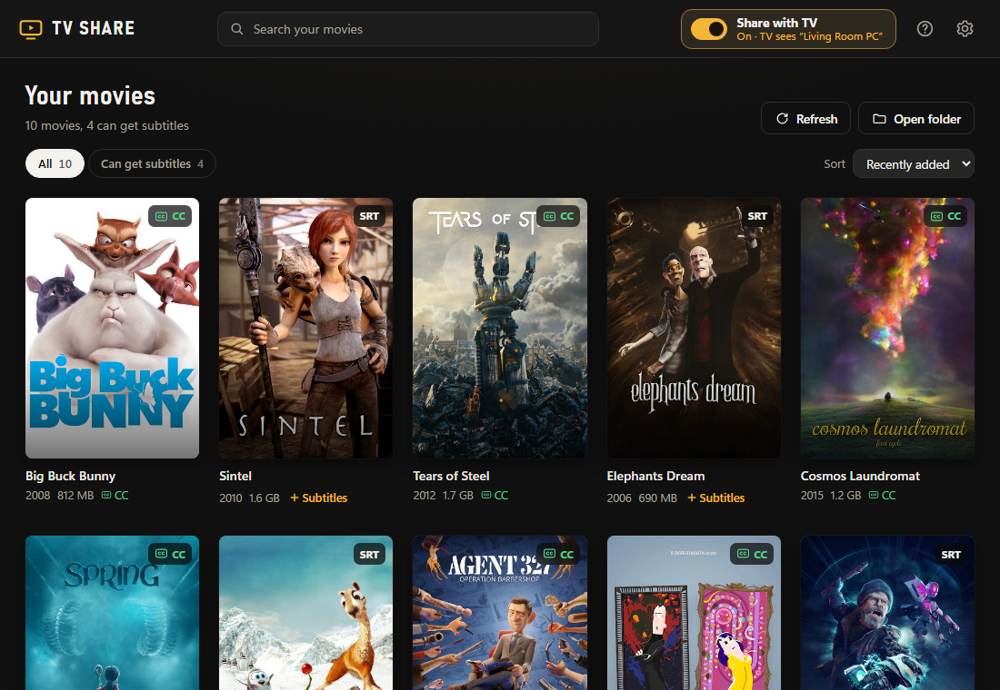

# TV Share

**Watch the movies on your Windows PC on your TV, with subtitles. No USB stick, no cables, no account.**



TV Share makes a folder on your PC (your *Videos* folder by default) show up on your TV, over your home Wi-Fi.
Open VLC on the TV, pick your PC, and play.

It also fixes the most common annoyance: **subtitles that don't show up on the TV.** TV apps usually ignore separate
`.srt` files when playing over the network. One click builds the subtitles *into* the movie file, with no re-encoding
and no quality loss. It takes about a minute.

## Download

1. Go to [**Releases**](../../releases/latest) and download **`TVShare-Setup.exe`** (4 MB).
2. Run it and click **Install**. No admin rights needed. You get a Start menu and desktop shortcut, and it shows
   up in *Settings → Apps → Installed apps* for uninstalling.
3. The first time the app opens, click **Install helpers**. TV Share sets up two free tools it needs (see below), using Windows' own installer.

Prefer no install? Download `TVShare.exe` instead and run it from anywhere (a USB stick, Downloads, ...).

> **"Windows protected your PC"?** The app isn't signed with a paid certificate, so Windows SmartScreen warns about
> new downloads. Click **More info → Run anyway**. The full source code is here if you want to check it or build it yourself.

Needs Windows 10 or 11, 64-bit.

## How to use it

**On the PC**
1. Open TV Share and click **Start sharing**.
2. If Windows asks whether to allow access on the network, click **Allow**.
3. Keep the app open and the PC awake while you watch.

**On the TV**
1. Install **VLC** from the TV's app store (free). Most smart TVs, Android TV / Google TV, Fire TV and game consoles have it.
2. In VLC, go to **Browse → Local network** and pick your PC's name (shown in the app under *TV sees it as*).
3. Open a movie.

VLC is the recommended player, but anything that can browse a "media server" (DLNA/UPnP) works: Kodi, Xbox and
PlayStation media players, and many TVs' built-in media apps.

**Subtitles**
- Movies with subtitles already inside show **Subtitles built in**. Nothing to do.
- Movies that came with `.srt` files (next to the movie or in a `Subs` folder) show an **Add subtitles** button.
  Pick the language and click it. The new file is checked (same length, subtitle track present) before anything
  else happens. Then the original goes to the **Recycle Bin**, never deleted outright. You can turn that off in Settings.
- Movie somewhere else (like Downloads)? Drag its folder onto the window to add subtitles. To watch it, move it into
  the shared folder.

## When something doesn't work

| Problem | Fix |
|---|---|
| The TV doesn't list your PC | Make sure both are on the **same Wi-Fi**. If the app says the network is *public*, click **Open network settings** and set it to **Private** (only on your home network). |
| The PC shows up but nothing loads | Close and reopen VLC on the TV (or *Force stop* it in the TV's app settings), then try again. |
| A movie won't start, or VLC jumps straight to another file in the folder | VLC is resuming the movie from a saved position at its very end, so it "finishes" instantly and moves on. In VLC, **long-press the movie and choose *Play from start***. (The saved position can exist even when the movie isn't listed in History.) Last resort: on the TV, *Settings → Apps → VLC → Clear data* (resets VLC's history and settings; *Clear cache* is not enough). |
| Playback stops after a while | The PC went to sleep. Keep it plugged in and set sleep to *Never* while on power. |
| "Port already in use" | Another copy of the share is running. Close it, or restart the PC. |
| Subtitles still don't show | In VLC, open the subtitle menu during playback and pick the track. |

## Privacy and safety

- The TV can **only read** the folder you choose. Nothing on your PC can be changed or deleted from the network.
- Sharing only happens while the app is open and **Start sharing** is on. It works on your local network only,
  with nothing sent to the internet.
- The only downloads are the two helpers below, from Windows' official package manager (winget).
- Settings are stored in `%APPDATA%\TV Share\settings.json`. To remove the app, uninstall it from *Installed apps*
  (or delete `TVShare.exe` if you used the portable version), then delete that folder if you want your settings gone too.

## What's under the hood

TV Share is a small (~11 MB) app built with [Wails](https://wails.io) (Go, with the window drawn by Windows' built-in
WebView2), so it stays light even on older PCs. It drives two well-known open-source tools:

- [**rclone**](https://rclone.org) (MIT) runs the media server (`rclone serve dlna`, read-only).
- [**FFmpeg**](https://ffmpeg.org) (LGPL/GPL) copies video and audio unchanged into an MKV with the subtitles added.

Both are installed with winget (`Rclone.Rclone`, `Gyan.FFmpeg`). If you'd rather not use winget, put `rclone.exe`,
`ffmpeg.exe` and `ffprobe.exe` next to `TVShare.exe` and the app will use them.

## Build it yourself

You need [Go](https://go.dev) (version in `go.mod`) and the Wails CLI:

```bash
go install github.com/wailsapp/wails/v2/cmd/wails@latest
git clone https://github.com/Mehdi-Ks/tv-share.git
cd tv-share
go test ./...
wails build -clean -trimpath
```

The app ends up in `build/bin/TVShare.exe`. To build the installer too, install [NSIS](https://nsis.sourceforge.io)
(`winget install NSIS.NSIS`) and run `makensis /DVERSION=1.0.0 build/installer/tvshare.nsi`, which writes
`build/bin/TVShare-Setup.exe`. The window is plain HTML, CSS and JavaScript in `frontend/dist`
(no Node.js or bundler needed). `wails dev` runs it with live reload.

## License

[MIT](LICENSE). Use it, change it, share it.
